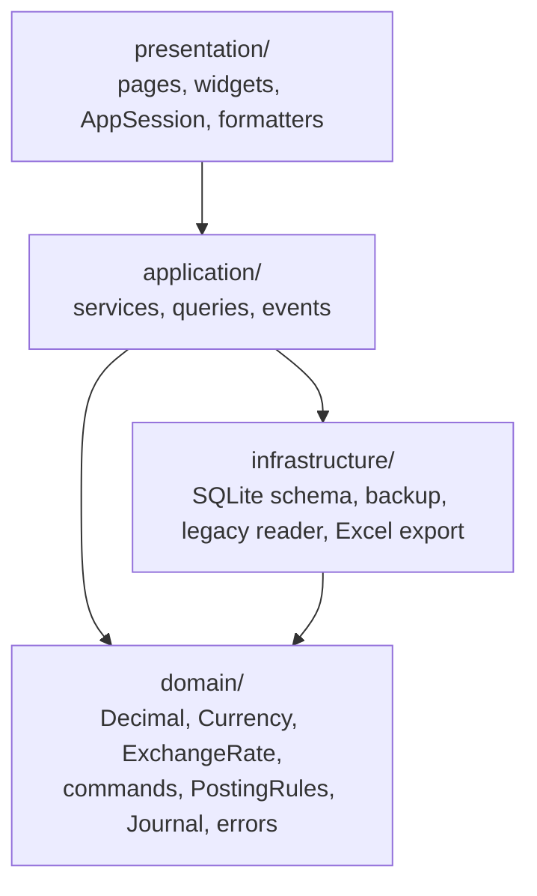

# Architecture

## Layers



| Layer | Folder | Rules |
|---|---|---|
| Domain | `lib/domain/` | Pure Dart. No Flutter, no database. Exact money (`Decimal`, integer minor units), currencies, the rate convention, financial commands, and `PostingRules`, which turn a command into a journal that must balance per currency. |
| Application | `lib/application/` | Services that own transactions and authorization: `PostingService`, `CustomerService`, `RateService`, `ReconciliationService`, `SecurityService`, `CatalogService`, `LedgerQueries` (read side), `LegacyMigrationService`, `AuditWriter`. `AppServices` is the composition root. |
| Infrastructure | `lib/infrastructure/` | `ExchangeDatabase` (open, migrate, seed), `schema_v1.dart`, `BackupService`, `LegacyReader`, `ExcelExport`. |
| Presentation | `lib/presentation/`, `lib/core/` | Pages and widgets. Widgets never write financial rows. They build a command, call a service, and show the result only after the service returns. |

## Write path

1. The page builds a command (for example `ExchangeCommand`) that carries an idempotency key generated when the form opened.
2. `PostingService.post(command, actor)`:
   1. Checks the actor's permission.
   2. Returns the existing transaction if the idempotency key was already used.
   3. Validates the date (no future dates, backdating window, reconciled-day lock).
   4. Asks `PostingRules` for a journal, which validates amounts, currencies, the walk-in rules, and the per-currency balance.
   5. Inside **one SQLite transaction**, resolves accounts, checks that cash will not go negative, and inserts the transaction, journal entry, lines, opening-balance registry row, and audit row.
3. Only after the commit, `LedgerEvents` notifies listeners. `AppSession` increments `revision`, and every page using the `RevisionReload` mixin reloads.
4. `runAction` shows a success toast only when the service returned normally, and shows the `DomainError` message otherwise. A new idempotency key is generated only after a successful post, so a retry after a failure can never create a duplicate.

## Read path

`LedgerQueries` computes everything from journal lines: cash per drawer and currency, customer positions, statements, journal search, trial balance, general ledger, exchange position, income and expense, exchange activity, and integrity problems. No balance is stored separately, so balances cannot drift away from the ledger.

## Session and security

- `SecurityService` stores salted PBKDF2-HMAC-SHA256 hashes (120,000 iterations), locks out for 5 minutes after repeated failures, and builds an `Actor` with role permissions.
- The app currently runs as the single owner account (user id 1) with an app lock (passcode/password, idle lock after 10 minutes, manual lock). The role and permission tables already support staff accounts; see the business decisions document.
- The legacy MAC-address allow-list, the trial lock, the hardcoded passwords, and the "911" bypass are removed.

## Folder map

```
lib/
  domain/        money/, exchange/, accounting/, transactions/, security/, shared/, errors/
  application/   app_services.dart, posting_service.dart, ledger_queries.dart, ...
  infrastructure/database/, backup/, legacy/, export/
  presentation/  pages/, widgets/, session/, format/, providers/
  core/          theme, generic widgets (Gf*), routing, constants, utils
test/
  domain/        pure rule tests
  integration/   real SQLite databases in temp folders
  ui_smoke_test.dart, app_lock_*, day_night_transition_test.dart, gf_scroll_behavior_test.dart
```

## Screens

| Route | Page | Permission |
|---|---|---|
| `/` | Dashboard: cash, customer receivables and liabilities per currency, today's activity, rates, integrity and backup warnings | – |
| `/exchange` | Buy / sell with live preview, settlement by cash or customer account, optional fee | `transactions.post` |
| `/cash` | Receipt, payment, expense | `transactions.post` |
| `/customers` | Search, create, edit, activate or deactivate | – (editing: `customers.manage`) |
| `/customers/statement?id=N` | Statement per currency, opening balance, adjustment, Excel export | – |
| `/journal` | Unified journal with composable filters, detail dialog, reversal | `reports.view` |
| `/reconciliation` | Daily count, difference, adjustment, close, reopen | `reconciliation.perform` |
| `/reports` | Position, daily, customer balances, exchange activity, trial balance, income/expense, general ledger, reconciliation history | `reports.view` |
| `/rates` | Rate board and history | – (editing: `rates.manage`) |
| `/settings` | Posting policies, opening cash, currencies, backup/restore, legacy import, app lock, appearance, audit log, integrity check | per card |
