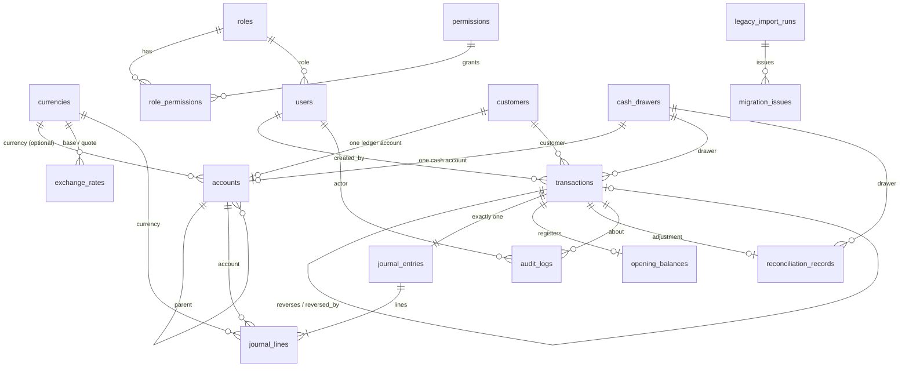

# Database

One SQLite file (`hadid_exchange.db`) opened through `sqflite_common_ffi` with `foreign_keys = ON`, `journal_mode = WAL`, `synchronous = FULL`, and a 5-second busy timeout. The schema lives in `lib/infrastructure/database/schema_v1.dart`; `ExchangeDatabase.open` applies migrations by `PRAGMA user_version` and seeds reference data in the same transaction.

## Conventions

- Money: `*_minor INTEGER` in minor units of the row's currency. Never REAL, never formatted text.
- Rates: canonical decimal TEXT (`"70.5"`), with the convention `1 base = rate quote`.
- Business dates: ISO `YYYY-MM-DD` (checked with `GLOB`). Timestamps: UTC ISO-8601.
- Foreign keys are integer ids. Names are never keys.

## ERD

## Tables

| Table | Purpose | Key constraints |
|---|---|---|
| `currencies` | Code, Persian name, symbol, amount precision (0–6), rate scale (0–12), rounding mode, active flag, order | Uppercase code; precision cannot change after postings exist (trigger) |
| `application_settings` | Key/value policies: `business.name`, `business.city`, `business.address`, `posting.max_backdate_days`, `posting.allow_negative_cash`, `posting.lock_reconciled_days`, `backup.auto_enabled`, `backup.auto_interval_hours`, `backup.retention_count`, `excel.auto_enabled`, `excel.auto_interval_hours`, `excel.auto_retention_count`, `excel.auto_directory` (empty = default folder) | – |
| `sequences` | Counters for reference numbers and customer codes | `value >= 0` |
| `roles`, `permissions`, `role_permissions`, `users` | Role-based access. Users store the display name shown in the app (`display_name`), an optional phone number (`phone`), PBKDF2 hash, salt, iteration count, failed attempts, lockout | Unique username (case-insensitive) |
| `customers` | Customer master data, status `active` / `inactive` / `anonymized`, walk-in flag, `legacy_id` | Exactly one walk-in; name required; no deletion (trigger) |
| `cash_drawers` | Cash drawers (صندوق) | Unique code |
| `accounts` | Chart of accounts with type, normal side, role, optional currency, parent, customer or drawer link | One account per customer and per drawer; one account per singleton system role; identity columns immutable; no deletion |
| `exchange_rates` | Rate history: buy and sell rate per ordered pair, effective time, author | `base <> quote` |
| `transactions` | Business header: type, status, customer, drawer, effective date, amounts, rate, settlements, fee, signed amount, reversal links, reason, idempotency key | Unique uuid, reference number, and idempotency key; buy/sell require a rate and two different currencies; only `posted → reversed` updates allowed (trigger); no deletion |
| `journal_entries` | One entry per transaction | Unique `transaction_id`; immutable |
| `journal_lines` | Debit or credit in one currency on one account | Exactly one side positive; immutable; the per-currency balance is enforced by the posting engine before insert |
| `opening_balances` | Registry of opening cash and opening customer balances | Unique active opening per drawer+currency and per customer+currency |
| `reconciliation_records` | Daily count per drawer, currency, date: opening, inflow, outflow, expected, counted, difference, status, adjustment link | `expected = opening + inflow − outflow`; `difference = counted − expected`; one non-void record per scope; closed records can only be reopened (trigger) |
| `audit_logs` | Append-only audit trail with actor, action, entity, outcome, reason, before/after JSON | No update, no delete (triggers). Never contains passwords or passcodes |
| `backup_history` | Every backup: kind (`manual`, `auto`, `pre_restore`, `pre_migration`), path, schema version, size, SHA-256 | – |
| `excel_export_history` | Every automatic Excel export attempt: full file path, time, outcome (`success` / `failure`), size, transaction count, error message. Not exported to Excel; carried over by Excel input and clear-all, like `backup_history` | – |
| `legacy_import_runs` | One row per import attempt: source fingerprint, status (`running`, `verified`, `failed`, `rolled_back`), summary JSON | A fingerprint can be `verified` only once |
| `migration_issues` | Issues and the full raw legacy archive of each run | – |

## Immutability triggers

| Trigger | Effect |
|---|---|
| `trg_journal_lines_no_update` / `_no_delete` | Journal lines can never change or disappear |
| `trg_journal_entries_no_update` / `_no_delete` | Same for journal entries |
| `trg_transactions_no_delete` | Transactions cannot be deleted |
| `trg_transactions_only_reverse` | The only allowed update sets `status = 'reversed'` and `reversed_by_transaction_id` once; every other column must stay identical |
| `trg_audit_no_update` / `_no_delete` | Audit log is append-only |
| `trg_customers_no_delete`, `trg_accounts_no_delete` | Deactivate instead of delete |
| `trg_accounts_identity` | Code, role, type, normal side, and links of an account cannot change |
| `trg_currency_precision` | Precision of a used currency cannot change |
| `trg_reconciliation_closed` | A closed record can only be reopened, without changing its figures |

## Migrations

`ExchangeDatabase.latestVersion` is 4. Version 2 (`schemaV2`) adds the append-only `transaction_corrections` table, which links an edited transaction to its reversal and its replacement. Version 3 (`schemaV3`) adds `excel_export_history`. Version 4 (`schemaV4`) adds `users.phone`. Each migration bumps `user_version` inside one transaction. Backups record the schema version, and a backup from a newer schema is refused on restore.

## Seed data

- Currencies AFN, USD, EUR (precision 2, rate scale 6), IRT (precision 0, rate scale 8), PKR (precision 2, rate scale 6), all with half-up rounding.
- Chart of accounts (see [05-accounting.md](05-accounting.md)), main drawer `صندوق اصلی`.
- Roles `admin`, `cashier`, `accountant`, `auditor` with default permissions; owner user (id 1) with the admin role.
- Walk-in customer `مشتری متفرقه` (code `WALK-IN`).
- Default settings listed in the table above (backdating 31 days, negative cash off, reconciled-day lock on, automatic backup every 24 hours keeping 30, automatic Excel export off with 24 hours and 30 files once enabled).
